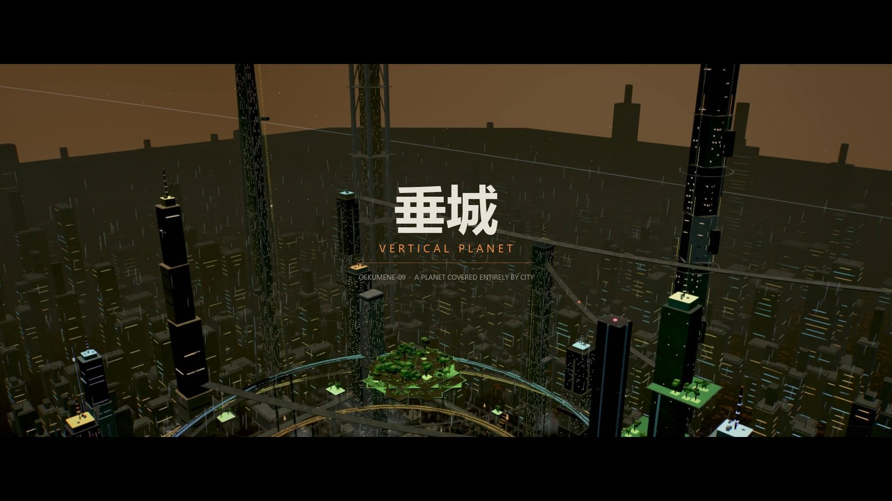
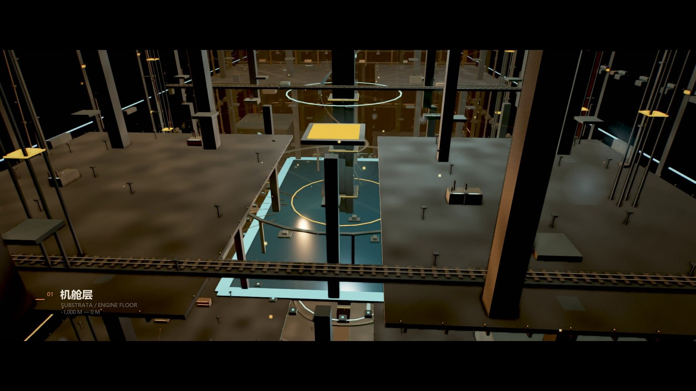
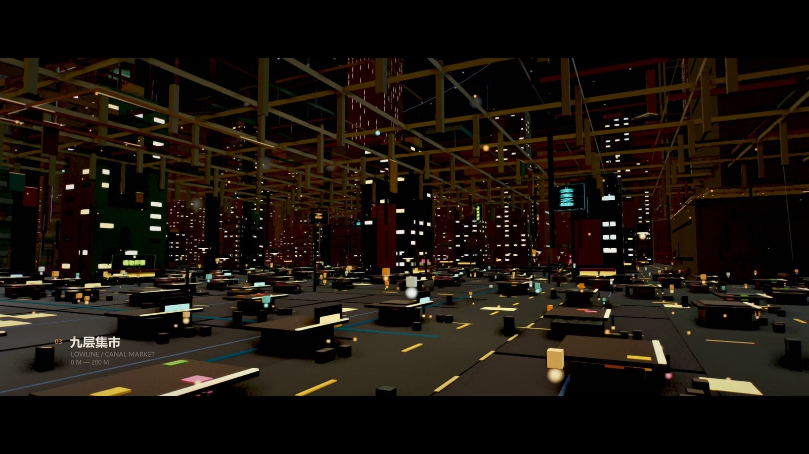
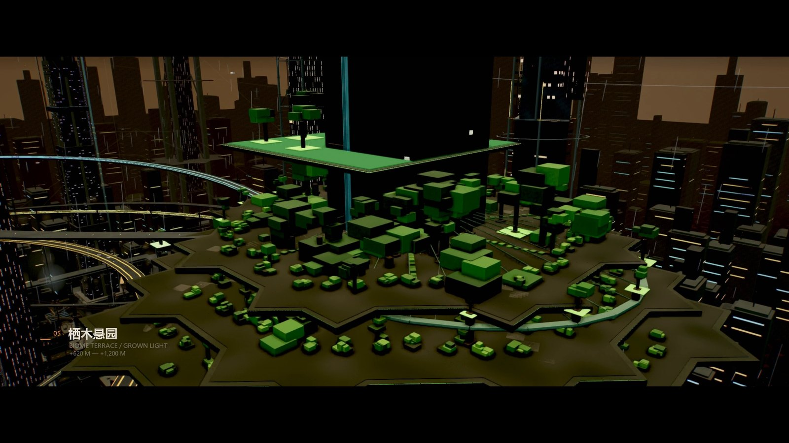
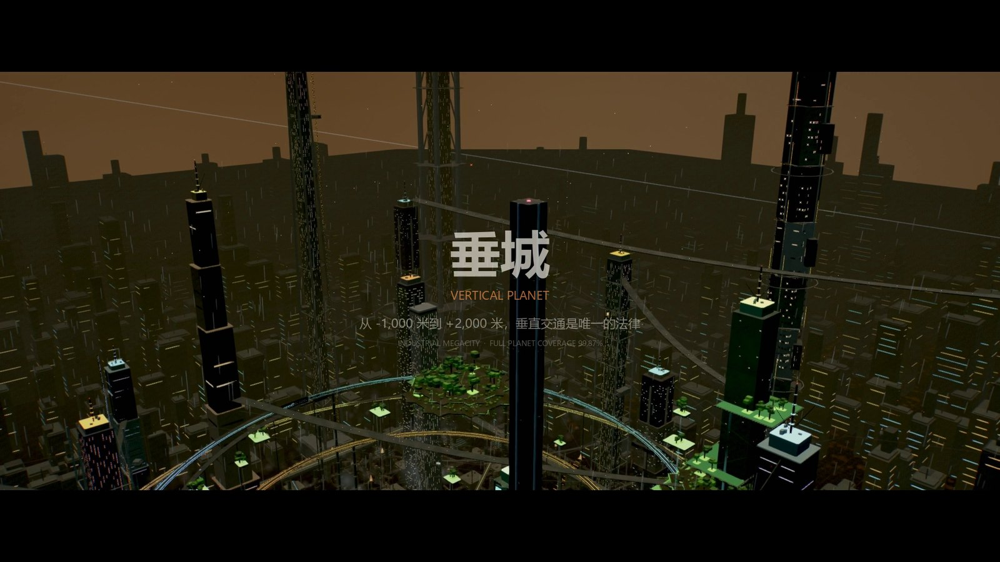

# 垂城 / VERTICAL PLANET

一颗被城市完全覆盖的星球。城市向下挖进地壳 1,000 米，向上生长到 2,000 米，
垂直交通是这里唯一的法律。

这是一个 **单文件、离线可运行** 的第一人称体素城市，附带一支 60 秒宣传片。
不需要服务器、不需要联网、不加载任何外部资源：Three.js 与全部城市生成代码都内联在
HTML 里，双击即可打开。



## 成品

| 文件 | 说明 |
| --- | --- |
| [`dist/垂城-VERTICAL_PLANET.html`](dist/垂城-VERTICAL_PLANET.html) | 可自由漫游的城市（约 950 KB，离线单文件） |
| [`dist/垂城-城市宣传片_VERTICAL_PLANET.mp4`](dist/垂城-城市宣传片_VERTICAL_PLANET.mp4) | 60 秒宣传片，1920×1080 / 24 fps / H.264 |

> 宣传片约 81 MB，已直接放在仓库中；若你只想看城市，下载 HTML 即可。

## 垂直剖面

城市的设定不是三层贴图，而是一套有真实连通的垂直系统：

**地下 −1,000 m → 0 m（机舱层）**
自动铸造厂、熔炉与铁水、货运轨道与龙门吊、成片的自建棚户、贯穿全井的管道与
散热脊柱、冷却湖与涡轮大厅，以及最底层的古老遗迹与发光裂隙。崖沿的贫民窟从
地表一直爬到井壁外侧，是上下两层真正的物理接缝。

**地表 0 → 200 m（低空层）**
西侧是仓库、炼油厂、储罐与冷却塔组成的工厂带；东南是九层集市，雨棚、灯串、
摊位与蒸汽挤在同一顶棚下；顶部约 176 m 处横着一层**人工天花板**——货运高架环线、
主干管廊与单轨列车，所以集市确实看不见天空。住宅区由窄楼、外挂楼梯、天桥与
屋顶棚屋堆叠而成。

**200 → 2,000 m（天穹层）**
19 座各自独立建模的塔（井架、阶梯塔、双塔、生态塔、广播塔、水塔、电梯塔、
螺旋塔、三足塔、钢格塔、轨道锚等，最高 1,982 米），三层云际环形立交、
中层连接桥、高空高架、悬空生态台地与温室，以及 59 辆在不同高度运行的飞车。

核心区之外还有 1,100 余栋远景城区建筑、46 座地平线巨塔与向远处延伸的城市灯毯，
从 900 米高空看是连续到地平线的城市，而不是一座孤城。






## 操作

| 输入 | 动作 |
| --- | --- |
| `W A S D` | 前后左右移动 |
| 鼠标 / 拖拽 | 第一人称视角 |
| `Space` / `C` | 上升 / 下降 |
| `Shift` | 加速穿梭 |
| 滚轮 | 切换五档航速（12 / 26 / 58 / 110 / 210 m/s） |
| `T` | 垂直交通目录（六个落点） |
| `1` / `2` / `3` | 直达地下层 / 低空层 / 天穹层 |
| `R` | 回到观景栈桥 |
| `H` | 操作指南 |
| `L` / `V` | 地标标注 / 隐藏界面 |
| `M` / `F` | 环境音效 / 全屏 |
| `P` | 画质预设 HIGH / MEDIUM / OFF |

## 渲染

- 场景先渲染到 **半浮点 HDR 缓冲 + 4×MSAA + 深度纹理**，再进入后处理链，最后 FXAA 输出。
- **SSAO**：深度重建视图空间、屏幕空间法线、半分辨率 12 采样，负责接触阴影。
- **三级 Bloom**：亮度阈值 → 降采样 → 分离式高斯模糊 → 叠加。
- **ACES 色调映射 + 电影调色**：teal 阴影 / 暖高光、对比、抬黑脚、边缘色散、暗角、
  按亮度加权的胶片颗粒。
- 材质为 **PBR（MeshStandardMaterial）**，一次性 PMREM 从场景本身烘焙 IBL；
  合并体素带有**程序化表面着色**（面板色差、烟熏/水渍垂痕、近地面湿痕）。
- 静态几何按空间分块合并，货箱与航空障碍灯使用实例化渲染，主力场景约 900 个绘制批次。

> 说明：单一 2K 级联的阴影在 1.6 km 体素场景上只会产生噪点，因此方向光阴影被关闭，
> 接触遮蔽由 SSAO 承担。

## 源码结构

```
src/
  template.html        HTML / CSS / HUD 外壳与界面
  part1_foundation.js  工具函数、渲染器、程序化纹理、体素批处理、天空、灯光
  part2_surface.js     地壳甲板、巨井、道路、标语与广告牌
  part3_towers.js      19 座塔的独立建模、塔冠、立面细节
  part4_substrata.js   地下七层：回收/铸造/管廊/棚户/轨交/机舱/基岩
  part5_lowcity.js     低空层：工厂、集市、住区、人工天花板
  part6_sky.js         云际立交、生态台地、远景行星城区
  part7_controls.js    第一人称控制
  part7b_post.js       SSAO / Bloom / ACES / FXAA 后处理与环境烘焙
  part8_ui.js          HUD、落点、音效、渲染循环
  part9_film.js        电影模式：十个镜头的确定性时间轴
  assemble.py          按顺序拼装为 city.js（电影模块注入 IIFE 内部）
  build.js             把 Three.js 与 city.js 内联进单个 HTML
  vendor/three.min.js  Three.js r149（MIT），构建时内联
tools/
  film.py              逐帧合成（遮幅、字幕卡、淡入淡出）并调用 ffmpeg 编码
  server.py            本地预览服务，接收页面推送的渲染帧
  frame_gate.py        客观帧门禁：检测黑帧与被近景结构遮挡的帧
docs/stills/           README 用剧照（从成片抽帧）
dist/                  单文件城市与成片
```

渲染宣传片时，`tools/` 下的脚本把中间帧写在自身目录（`film_frames/`、
`film_clean/`），这些目录已在 `.gitignore` 中排除。

重新构建 HTML：

```bash
cd src
python assemble.py     # 拼装 part*.js -> city.js
node build.js          # 内联 Three.js，输出 dist/垂城-VERTICAL_PLANET.html
```

Three.js 已放在 `src/vendor/three.min.js`，构建不需要联网。

## 宣传片

10 个镜头，硬切，每段 6 秒。镜头在已逐一渲染验证的机位上做缓慢推移，
并带有独立曝光与雾密度曲线；成片叠加 2.39:1 遮幅、双语字幕卡与淡入淡出。

渲染流程：页面内的电影模式按固定时间轴逐帧绘制 1920×1080，用
`gl.finish()` + 2D 画布快照稳定抓帧后回传本地服务，Python 合成遮幅与字幕，
最后由 ffmpeg 以 CRF 17 / H.264 High 编码。

全片 1,440 帧都经过客观门禁扫描：只命中片头与片尾约 0.6 秒的设计性淡入淡出，
主体镜头无遮挡、无撕裂。

## 许可

代码与生成的城市用于学习与展示。Three.js 版权归其作者（MIT）。
